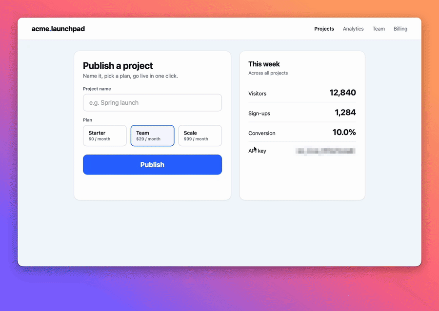
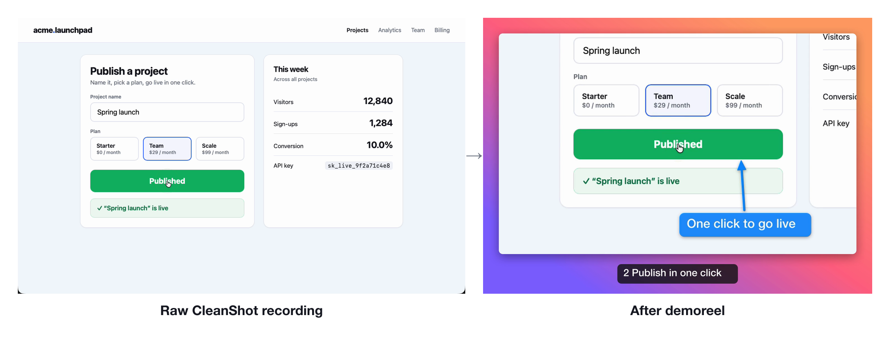
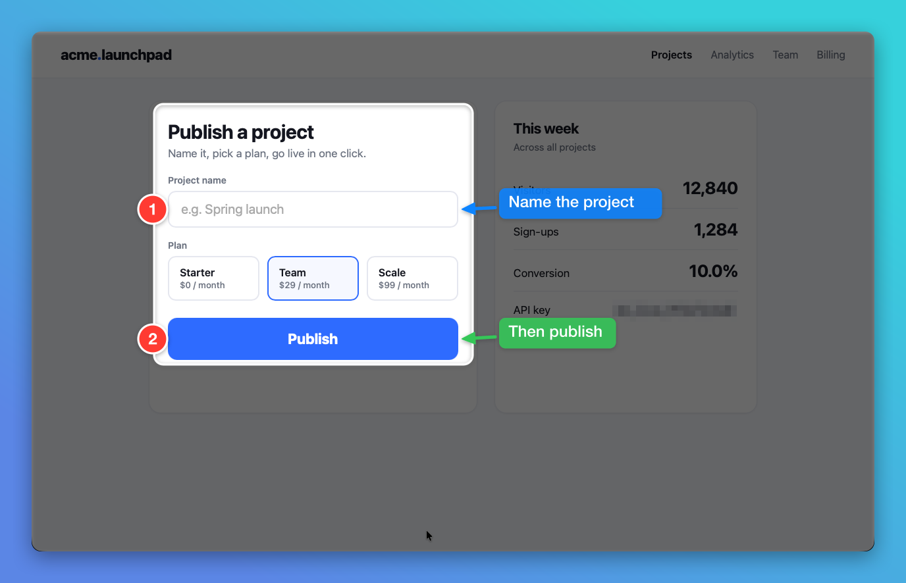

# demoreel-mcp

An MCP server that lets an AI agent **record, annotate and polish product demo videos on macOS** by driving [CleanShot X](https://cleanshot.com).



<sub>That clip was made by demoreel itself, from one `record_demo` call and one `polish_video` call. The settings are in [`docs/demo.record.json`](docs/demo.record.json) and [`docs/demo.polish.json`](docs/demo.polish.json); the full-quality video is [`docs/demo.mp4`](docs/demo.mp4).</sub>

One tool call can arrange the app window, start a CleanShot recording, move the pointer and type like a person, stop, and hand back a finished video with smooth zooms on every click, captions, a framed gradient background and title cards.



> Unofficial. Not affiliated with or endorsed by CleanShot X or MakeTheWeb. You need your own CleanShot X licence.

## Why demoreel, and how it compares

CleanShot X has an official [URL-scheme API](https://cleanshot.com/docs-api), and an earlier open-source MCP, [`jdorfman/cleanshot-mcp`](https://github.com/jdorfman/cleanshot-mcp), wraps it. That is a fine way to trigger a screenshot. It cannot produce a demo video, because the API itself has three gaps. demoreel closes each one.

| Gap in the official API | How demoreel closes it |
| --- | --- |
| **It can open the recorder but not press Record or Stop.** | A small Swift helper presses CleanShot's own buttons through the macOS Accessibility API, answers its follow-up prompts, closes its editor window and returns the file. |
| **Recorder options (mic, system audio, camera, click highlight, keystrokes) are not exposed.** | The same helper reads each toggle's state in the recorder panel and flips only the ones that differ, and can pick a camera or microphone by name. Other preferences can be read and written with a backup taken first. |
| **Annotation is a GUI — nothing can be drawn by command.** | A declarative renderer: describe arrows, boxes, callouts, numbered steps, spotlights and blurs in JSON and get pixels back. The same marks work on video with start and end times. |

### Side by side

Compared with the other CleanShot MCP server, judged from its published README and tool list (`TOOLS.md`, `API.md`) on 2026-11-25:

| | `cleanshot-mcp` | **demoreel-mcp** |
| --- | --- | --- |
| Take a screenshot (area, window, fullscreen) | Yes — opens the mode | Yes — captures and returns the saved file |
| Scrolling capture | Opens the mode; you scroll and finish it | Scrolls to the end, finishes, returns one stitched image |
| Start a screen recording | Opens the recorder | Opens it, sets the toggles, presses Record |
| **Stop a recording and get the file** | No tool for it | Yes, with the file path and video properties back |
| GIF and Studio Mode recording | No | Yes; Studio projects are exported to MP4 |
| Mic / camera / click-highlight / keystroke toggles | No | Yes, including choosing the device |
| **Draw annotations** | Opens CleanShot's Annotate window for a person | Renders arrows, callouts, steps, spotlight, blur and pixelate from JSON |
| Annotate **video** | No | Yes, with timing |
| Drive the app being demoed (pointer, typing, scrolling) | No | Yes, with eased pointer motion |
| Auto-zoom on clicks, captions, framed background, intro/outro, trim, speed, GIF | No | Yes |
| Arrange the app window so every take looks the same | No | Yes |
| Keeps CleanShot's own overlay and system prompts out of captures | No | Yes |
| Change CleanShot's settings | Opens the settings window | Reads, writes (with backup) and restores them |
| Coordinates | CleanShot's bottom-left origin | Top-left, like window bounds, converted for you |
| One call for a whole recorded, edited demo | No | `record_demo` |
| Install | `npx cleanshot-mcp` | Clone and `npm install` for now |

Everything `cleanshot-mcp` exposes is also reachable here through `cleanshot_command`, which validates parameters against the official API.

**What the other server does better:** it is simpler, and installs with one `npx` command. If you only want an assistant to open CleanShot's capture modes and you will click the rest yourself, it is the lighter choice.

**What a general computer-control MCP does not give you:** a generic "click and type on the Mac" tool can press CleanShot's buttons, but it does not know the recorder's layout, its audio prompts, its overlay windows or its editor, and it cannot edit the video afterwards. demoreel encodes all of that and tests it against a real CleanShot.

The result is a different kind of tool: not "trigger a screenshot", but "give an agent a script and get a finished demo back".

## Requirements

- macOS 13+ and [CleanShot X](https://cleanshot.com) 4.7+ (developed against 5.0.4), running
- CleanShot → Settings → Advanced → API → **Allow applications to control CleanShot**
- **Accessibility** permission for the app that launches the server (Claude, your terminal, Cursor…): System Settings → Privacy & Security → Accessibility
- Node.js 18+, `ffmpeg` (`brew install ffmpeg`), Xcode Command Line Tools (`xcode-select --install`) — the helper is compiled on first use

## Install

```bash
git clone https://github.com/rkapdi/demoreel-mcp.git && cd demoreel-mcp && npm install
```

Claude Code:

```bash
claude mcp add demoreel -- node /absolute/path/to/demoreel-mcp/src/index.js
```

Claude Desktop / Cursor / any MCP client:

```json
{ "mcpServers": { "demoreel": { "command": "node", "args": ["/absolute/path/to/demoreel-mcp/src/index.js"] } } }
```

Then ask the agent to run the `doctor` tool. It reports anything missing.

## Tools

| Tool | What it does |
| --- | --- |
| `doctor` | Checks CleanShot (installed, running, answering), permissions, ffmpeg, displays, and any macOS prompt waiting on screen. |
| `record_demo` | Whole take in one call: arrange window → record → scripted steps → stop → optional polish. Returns the file and a click timeline. Works with video, GIF and Studio Mode. |
| `record_start` / `record_stop` / `record_status` / `record_cancel` | Manual control of a CleanShot recording. Video, GIF, or Studio Mode (exported to MP4 through CleanShot's own editor, project kept alongside). |
| `perform_actions` | Eased pointer glides, clicks, drags, smooth scrolling, typing, shortcuts, waits. |
| `polish_video` | Zooms, timed annotations, captions, framed background, intro/outro, trim, speed, MP4/GIF. |
| `annotate_image` | Arrow, line, rect, ellipse, highlight, text, callout, step, spotlight, blur, pixelate; crop; framed background. Can open the result in CleanShot's Annotate or pin it. |
| `screenshot` | CleanShot capture of an area, window or display. `scrolling: true` scrolls the content to the end and returns one tall stitched image. |
| `clear_overlays` | Dismiss CleanShot's Quick Access Overlay items and tip bubbles. |
| `video_frames` | Stills at given times, so the agent can look before placing marks. |
| `list_windows` / `arrange_window` | Find and frame the app being demoed. |
| `cleanshot_settings` | Read, change (with backup) and restore CleanShot preferences. |
| `cleanshot_command` | Any official `cleanshot://` command, validated. |

Recorder options: `microphone` and `camera` take `true`, `false` or part of a device name; `cameraSize` (small/medium/large/huge); `cameraShape` (circle/square/rectangle/vertical); `systemAudio`, `highlightClicks`, `keystrokes`.

### Coordinates

- Screen tools use **points, origin at the top-left of the main display** (the same space as window bounds). The server converts to CleanShot's bottom-left origin for you.
- In `record_demo`, step coordinates are **relative to the capture area**.
- `annotate_image` and `polish_video` use **pixels of the image / source video**. Times are **seconds in the source video**.

### Example: a full take

This is the take behind the clip at the top. It has two calls: record, then polish. `docs/demo.record.json` and `docs/demo.polish.json` hold the exact files, and `examples/acme-demo.html` is the page being demoed (`cd examples && python3 -m http.server 8765`, then open `http://127.0.0.1:8765/acme-demo.html`).

`record_demo` — step coordinates are relative to the capture area:

```json
{
  "area": { "x": 160, "y": 150, "width": 1280, "height": 790 },
  "options": { "highlightClicks": true, "systemAudio": false, "camera": false },
  "hideDesktopIcons": true,
  "steps": [
    { "do": "click", "x": 427, "y": 270, "ms": 900, "pause": 500 },
    { "do": "type", "text": "Spring launch", "ms": 85, "pause": 900 },
    { "do": "click", "x": 427, "y": 467, "ms": 900, "pause": 1800 }
  ],
  "output": "out/raw.mp4"
}
```

It returns the video and a timeline of clicks, in video seconds and pixels, so the agent knows when each thing happened.

`polish_video` — times are seconds in the raw video, coordinates are pixels in it:

```json
{
  "input": "out/raw.mp4",
  "trim": { "start": 0.8, "end": 12.4 },
  "zooms": [{ "start": 6.3, "end": 8.9, "x": 427, "y": 467, "scale": 1.7 }],
  "annotations": [
    { "type": "pixelate", "x": 872, "y": 407, "width": 208, "height": 34, "start": 0.8, "end": 12.4 },
    { "type": "callout", "x": 430, "y": 612, "text": "One click to go live", "target": [560, 502], "background": "blue", "start": 5.6, "end": 8.6 }
  ],
  "captions": [{ "text": "2  Publish in one click", "start": 6.2, "end": 8.9 }],
  "background": { "gradient": "sunrise", "padding": 56 },
  "output": "out/demo.mp4"
}
```

Prefer not to place zooms by hand? Pass `"autoZoom": true` inside `record_demo`'s `polish` and a smooth zoom is added on every click.

### Example: annotate a screenshot



The image above came from this call (`docs/annotate.spec.json`), with no GUI involved:

```json
{
  "input": "page.png",
  "annotations": [
    { "type": "pixelate", "x": 872, "y": 407, "width": 208, "height": 34, "block": 9 },
    { "type": "spotlight", "x": 186, "y": 110, "width": 484, "height": 396, "dim": 0.5 },
    { "type": "step", "x": 184, "y": 270 },
    { "type": "callout", "x": 710, "y": 238, "text": "Name the project", "target": [654, 270], "background": "blue" }
  ],
  "background": { "gradient": "ocean", "padding": 48 }
}
```

Gradient presets: `sunrise ocean violet mint peach midnight sky ember slate forest`, or pass your own list of colours.

## How it works

- `helper/axhelper.swift` — ~250 lines. Reads an app's accessibility tree as JSON, presses elements, moves/resizes windows, and posts mouse and keyboard events with easing. Compiled to `~/.demoreel/bin/axhelper` on first use.
- `src/cleanshot.js` — official URL commands, recorder control, file pickup, settings.
- `src/annotate.js` — marks → SVG → pixels via [sharp](https://sharp.pixelplumbing.com).
- `src/video.js` — builds one ffmpeg filter graph from the spec.
- `src/actions.js` — scripted input and the click timeline.

No private CleanShot APIs, no code injection, no patching: the server only opens documented URLs and presses buttons a person could press.

## What is kept out of your captures

- **CleanShot's Quick Access Overlay.** Every overlay item and tip bubble is dismissed before each capture and again afterwards, so thumbnails of earlier captures never appear in a screenshot or recording. Dismissed captures stay in CleanShot's Capture History. Pass `keepOverlay: true` to leave them alone.
- **CleanShot's editor and trimmer windows.** They are closed after each recording.
- **macOS permission prompts.** A capture is refused if a system prompt covers the area (it would be burned into the video); `doctor` reports any prompt that is waiting.

## Limits and notes

- **UI-driven parts can break when CleanShot changes its recorder panel.** Verified on 5.0.4. `doctor` and explicit error messages are the safety net; please open an issue with your version if something stops matching.
- **Camera needs CleanShot's own camera permission.** The first time, macOS asks "Allow CleanShot X to access your camera?" — only you can answer that. Until you do, the recording has no camera bubble.
- Microphone and camera are chosen from a device menu; the server clicks the menu item with the real pointer (selecting it through accessibility makes CleanShot 5.0.4 quit). It prefers the Mac's built-in device over an iPhone.
- With the camera on and no microphone, CleanShot asks about audio; the server answers "Don't Record Audio". With microphone **and** system audio, it asks about merging tracks; the server answers "Don't Merge". `record_demo` turns the microphone off unless you ask for it.
- Files passed to CleanShot (`open-annotate`, `pin`, …) are first copied to `~/.demoreel/handoff/`, because CleanShot freezes behind a permission prompt when asked to read from Desktop, Documents or Downloads.
- Recordings are copied to `~/Movies/demoreel/` (or your `output`), because CleanShot deletes its temporary copy when its overlay item is dismissed.
- Scrolling capture follows the target's scrollbar to know when to finish. If the app exposes no scrollbar to accessibility, it scrolls for `scrollSeconds` (default 10) instead.
- Studio Mode export uses the editor's default settings (original resolution). Zooms added by `polish_video` are rendered by ffmpeg, not by CleanShot's editor.
- Text width for labels is estimated, so very long labels may need a `size` tweak.
- `cleanshot_settings` only writes six keys that were verified by toggling the matching control and diffing; anything else needs `allowUnverified: true`.
- The server moves your real pointer and types into the frontmost app while a script runs. Don't touch the Mac during a take.

## Performance, and why this is not written in Rust, Go or assembly

Measured on an M-series MacBook Pro:

| Step | Time |
| --- | --- |
| Reading CleanShot's interface (one helper call) | ~30 ms |
| Sending a `cleanshot://` command | ~75 ms |
| Server start + handshake + one tool call | ~230 ms |
| Polishing a 10 s 1200×800 take (zooms, captions, frame, cards) | ~5 s, all inside ffmpeg |
| The take itself | as long as the demo runs |

The server's own code accounts for well under 1% of a take. The time goes to CleanShot's animations, waiting for the demo to play, and ffmpeg encoding, which is already hand-optimised native code. The one part that must be native — talking to the Accessibility API and posting input events — is a compiled Swift binary. Rewriting the orchestration layer in another language would not make a take measurably faster and would cost the ecosystem pieces (MCP SDK, sharp) that keep it small.

## Development

```bash
npm test                       # unit tests (no CleanShot needed)
node test/client.mjs           # list tools
node test/client.mjs doctor    # call a tool: node test/client.mjs <tool> '<json>'
```

## Licence

MIT
